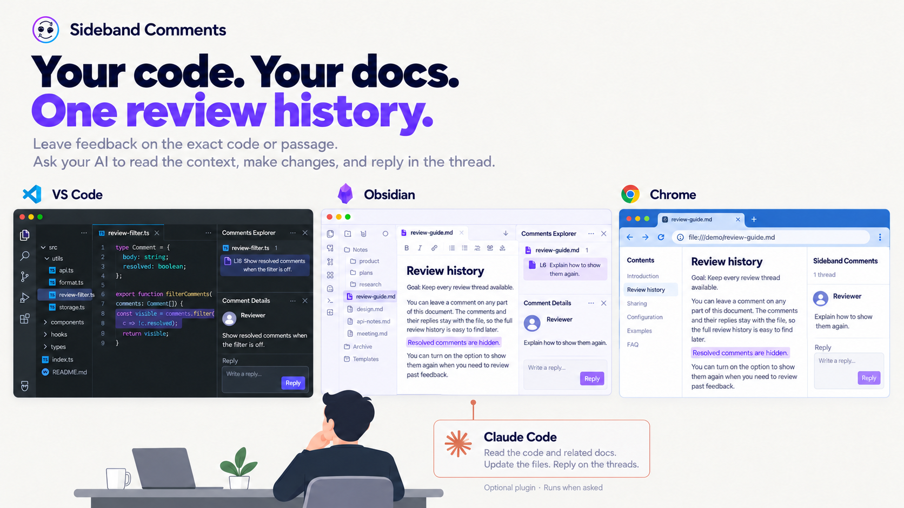
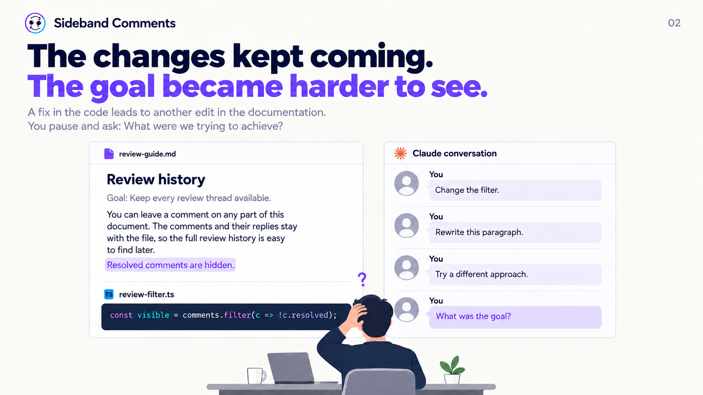
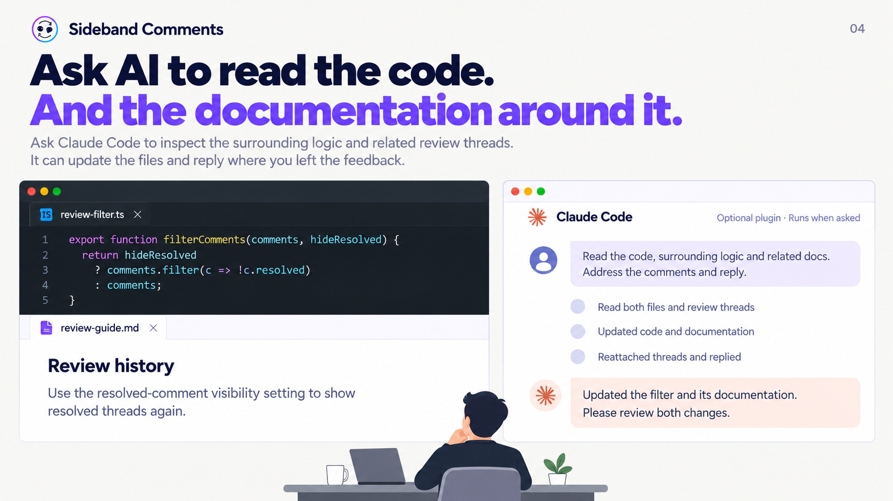

# Sideband Comments

<p align="center">
  
</p>

<p align="center"><strong>Work with AI where the document lives.</strong></p>

<p align="center"><strong>English</strong> · <a href="README.ko.md">한국어</a></p>



*Illustrated workflow with sample code and simplified app layouts. Claude Code is an optional, separately installed integration.*

AI conversations move fast, but the reasoning behind a change often disappears into chat history. Sideband Comments anchors questions, replies, and decisions to the exact text under review while keeping the document itself clean.

Review source code in VS Code and Markdown in Chrome, VS Code or Obsidian. Comments on related files stay in the project's local review history. People inspect the resulting changes and decide when to resolve a thread. With the optional agent plugin, ask Claude Code or Codex to read the comments, surrounding code and related documentation, make the requested changes, and reply on the threads.

## Why I built this

While working with Claude, I kept quoting passages from a document into chat: “Change this paragraph.” “Fix that sentence.” Each request led to another, until I lost sight of the goal I had started with.

I built Sideband Comments to keep those requests attached to the file being reviewed. A comment points to the code or passage under discussion, the agent can read it when asked, and its reply stays in the same thread. I can review the changed code and documentation alongside the requests and reasons for the changes before deciding whether the work is done.

The aim is to keep the document, the conversation, and the original goal in view together. Sideband provides a place for that context; I still decide what to ask, what to accept, and when to resolve a thread.

Write the goal in the document so it can be read again. In a new session, ask the agent to read that same accessible document and its comment history; Sideband does not automatically transfer the previous chat or guarantee that the agent will understand every part of it.



[Follow the five-scene story: from repeated revisions to a reviewed change.](docs/review-story.md)

## Chrome

A Chrome reader with GitHub styling, Mermaid, a left TOC and a right Sideband comment panel is available for local development. It uses a Native Messaging host and works without VS Code running. See [macOS installation, usage and validation](docs/chrome.md). The initial Chrome Web Store submission is awaiting review. Until it is published, use the developer-mode installation described in the guide.

## Why

- **Context attached to the exact text** — keep each discussion beside the passage, paragraph, or code range it concerns.
- **One review history across your tools** — continue the same local conversation in Chrome, VS Code and Obsidian; ask your agent to read it when needed.
- **Original text preserved for verification** — compare what was reviewed with what the document says now.
- **Local-first, append-only storage** — retain the full discussion history without embedding review data in the document.

## Built for code and writing

Sideband Comments is not limited to developer code review. A developer can review AI-assisted code in VS Code while a writer, researcher, or knowledge worker reviews AI-assisted prose in Obsidian. Both workflows use the same document-grounded conversation model: comment on an exact passage, inspect the change, and resolve only after verification.

When a file-aware AI tool has access to the workspace, instructions and replies can stay attached to the source instead of being repeatedly transferred through a separate chat. Sideband Comments does not call an AI service and requires no MCP server; the agent skill it ships is optional. It provides the durable local review layer that people and tools can share.

## How it works

1. Write the goal in your project notes and select the exact code or passage that needs discussion.
2. Leave a comment explaining what needs to change and why.
3. Ask your agent to read the file, surrounding logic, related documentation and review threads, make the requested changes, and reply. When quoted text is rewritten, the skill reattaches the thread before replying.
4. Review the updated code and documentation together, alongside the original quotations and replies. Add a follow-up comment and ask the agent to continue, or resolve the thread when your review is complete.



Comment actions leave Markdown and source files unchanged. An AI tool you ask to revise the document can change its contents. Chrome and both editor integrations share one append-only store:

```text
.comments/
├── documents/
│   └── <bundle-id>.jsonl    one file per document, holding its threads
└── threads/
    └── <thread-id>.jsonl    earlier layout, still read
```

## Installation

### VS Code

Install from the [Visual Studio Marketplace](https://marketplace.visualstudio.com/items?itemName=insung.sideband-comments-vscode), or search **Sideband Comments** in the Extensions view.

Comments Explorer groups commented files by workspace and directory. In Comment Details, double-click a comment body to open Save/Cancel editing (or focus it and press Enter). Delete opens a VS Code confirmation dialog; confirming hides the comment while preserving its JSONL history.

### Obsidian

Install from [Obsidian Community Plugins](https://community.obsidian.md/plugins/sideband-comments), or search **Sideband Comments** under Settings → Community plugins → Browse.

The Obsidian adapter is desktop-only. It provides Live Preview highlights plus a two-part sidebar: a directory-tree comment explorer above the selected note's inline comment, reply, edit, delete, resolve, re-anchor, and resolved-visibility controls. The new-comment composer previews the current editor selection, and existing comment bodies open inline editing on double-click. Reading View range mapping is not included yet.

### Building from source

To try an unreleased change, package the app yourself and install the artifact:

```bash
npm run package --workspace sideband-comments-vscode
code --install-extension apps/vscode/dist/sideband-comments-vscode-<version>.vsix --force
```

```bash
npm run package --workspace sideband-comments-obsidian
```

For Obsidian, copy `main.js`, `manifest.json`, and `styles.css` from `apps/obsidian/dist/` into `<vault>/.obsidian/plugins/sideband-comments/`.

### AI agents

The `sideband-comments` plugin gives Claude Code and Codex an agent skill, so you can ask them to
read the comments on a file, fix what they ask for, and reply on the thread.

```bash
claude plugin marketplace add insung/sideband-comments
claude plugin install sideband-comments@sideband-comments
```

```bash
codex plugin marketplace add insung/sideband-comments
codex plugin add sideband-comments@sideband-comments
```

The plugin installs only `plugin/` — two skills and the tool — not the editor code. It has no
hooks, so it runs nothing until you ask. Its version always matches the VS Code extension and the
Obsidian plugin.

Then ask the agent to "set up Sideband Comments". The `setup` skill checks the VS Code extension, the
Obsidian plugin and the project's `.comments` directory, and asks before it installs or creates any
of them. It installs the VS Code extension with `code --install-extension`, and opens the Obsidian
plugin page (`obsidian://show-plugin?id=sideband-comments`) so you install and enable it there. Codex
offers `setup` as the plugin's onboarding step.

Copilot CLI and Gemini CLI can link `plugin/skills/sideband-comments` into `~/.agents/skills/`. The skill needs
Python 3.9 or later and works on any project with a `.comments` directory.

A comment is anchored to a quote of the document text, so editing that text orphans the thread — the
skill re-anchors it before replying, and never resolves a thread on your behalf.
[Read the guide](docs/agent-skill.md).

## Migrating Tandem Comments

[Tandem Comments](https://community.obsidian.md/plugins/tandem-comments) is an Obsidian plugin that keeps review threads inside the note, in fenced blocks. This migration lifts those threads out into the `.comments` store, leaving the Markdown clean.

Migration is a dry-run unless `--write` is explicitly supplied.

```bash
npm run build --workspace @sideband-comments/migrate
node packages/migrate/dist/sideband-migrate.js /path/to/vault
node packages/migrate/dist/sideband-migrate.js /path/to/vault --write
```

The write path records JSONL events before atomically replacing each Markdown file. Existing thread IDs with different events stop the migration instead of being overwritten.

## Architecture

```text
packages/core/          editor-neutral domain and use cases
packages/jsonl-store/   .comments persistence adapter
packages/migrate/       Tandem fenced-block migration
apps/vscode/            VS Code CommentController adapter
apps/obsidian/          Obsidian sidebar and Live Preview adapter
plugin/                 Claude Code and Codex plugin: agent skills and their tool
```

The core owns thread events, deterministic folding, quote anchors, edit/delete history, resolve/reopen, re-anchor, and file relocation. Editor packages only translate host API events into core use cases. VS Code and Obsidian both present a workspace-wide file explorer above a selected-file detail editor, including re-anchor and show/hide-resolved controls.

## Development

Requirements: Node.js 20 or newer and npm.

```bash
npm install
npm test
npm run typecheck
npm run build
```

## App version policy

Chrome, VS Code, Obsidian and the agent plugins share one release version, even when only one component changes. Chrome and Obsidian package versions must also match their respective manifests exactly.

`npm test`, the root build, each app package command, and the `App version policy` GitHub Actions check run the same validation:

```bash
npm run check:app-versions
```

Require the `app-version-policy` status check in the default branch protection rules to prevent mismatched version lines from being merged.

## Git synchronization

Tracking `.comments/` in Git keeps comment history available on other computers and allows the VS Code and Obsidian extensions to share it. This removes review-only changes from Markdown and code files, but comment activity still creates changes under `.comments/`. Ignoring `.comments/` avoids Git changes at the cost of requiring another synchronization mechanism.

## Inspiration and license

Sideband Comments is inspired by [Tandem Comments](https://community.obsidian.md/plugins/tandem-comments) and Anchored Comments. This repository is a new MIT-licensed implementation of the sidecar protocol and editor adapters; it includes no MCP server, and its agent skill is optional.
