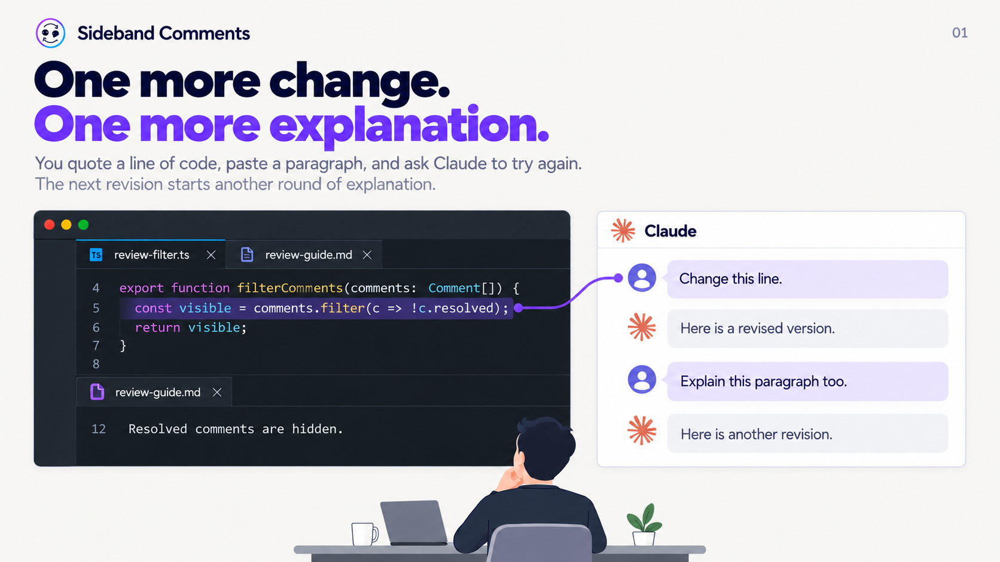
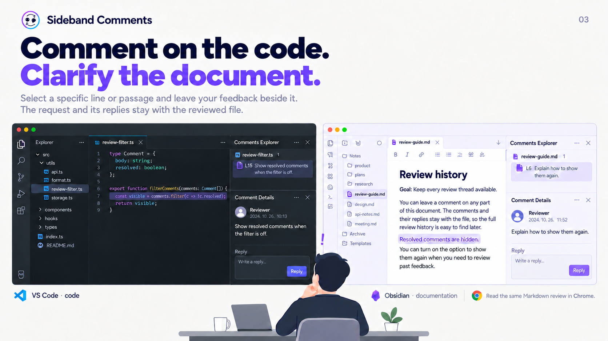
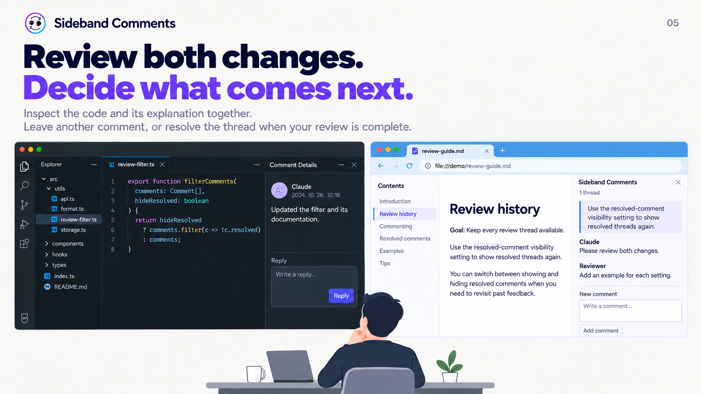

# 코드와 문서, 하나의 검토 이력

[English](review-story.md)

Sideband Comments는 구절을 Claude에 계속 인용하고 수정 요청을 이어가다가 처음 목표를 놓친 경험에서 출발했습니다. 검토 대상은 문서의 문장뿐 아니라 코드 한 줄, 함수의 동작, 그 동작을 설명하는 문단일 수도 있습니다.

이미지는 제공된 앱 화면 배치를 참고해 단순화한 설명용 일러스트입니다. 실제 캡처나 에이전트 실행 증거가 아닙니다. 코드는 배포된 Sideband 구현이 아닌 예제입니다. Claude Code는 별도로 설치하며 요청했을 때 실행하는 선택적 연동입니다.

## 1. 한 번 더 고치고, 한 번 더 설명하기

사용자는 `review-filter.ts`의 코드 한 줄을 인용하고, `review-guide.md`의 문단을 붙여 넣으며 Claude에 다시 요청합니다. 한 파일의 수정은 다른 파일에 대한 추가 설명으로 이어집니다.



## 2. 수정은 이어지지만 목표는 흐려진다

예제의 목표는 가이드에 적힌 **검토 스레드를 다시 찾아볼 수 있도록 유지하기**입니다. 작은 수정을 이어가던 사용자는 “우리가 무엇을 이루려고 했지?”를 떠올립니다. 목표가 지워진 것이 아니라 다음 변경에 주의가 쏠린 경험입니다. Claude를 쓰면 반드시 이런 결과가 생긴다는 주장은 아닙니다.


## 3. 코드에는 동작을, 문서에는 설명을 묻기

VS Code에서는 해결된 댓글을 항상 제외하는 코드 구절을 선택해 **“필터를 끄면 해결된 댓글도 보여줘.”**라고 남깁니다. Obsidian에서는 “Resolved comments are hidden.”이라는 문장을 선택해 **“다시 표시하는 방법을 설명해줘.”**라고 남깁니다. Chrome에서도 같은 로컬 Markdown의 검토 이력을 읽습니다. Chrome이 임의의 소스 파일을 편집하거나 코드 블록 선택을 지원하는 것처럼 표현하지 않습니다.

댓글은 체크박스 안이 아니라 선택한 코드나 문장에 연결된 검토 패널에 놓입니다. 코드와 문서는 같은 프로젝트의 로컬 이력을 사용하되 각 파일에 별도 스레드가 붙습니다. 앱별 화면 배치도 구분합니다.



## 4. AI에게 코드와 관련 문서를 함께 읽도록 요청하기

사용자가 명시적으로 요청합니다.

> 코드와 주변 로직, 관련 문서를 읽어줘. 댓글의 요청을 반영하고 같은 스레드에 답글을 남겨줘.

예제에서 에이전트는 `hideResolved` 설정을 따르도록 필터를 바꾸고, 해결된 스레드를 다시 표시하는 방법을 가이드에 추가합니다. 인용문을 고쳐 쓰면 스킬은 수정된 구절에 스레드를 다시 고정한 뒤 답글을 남깁니다.

> 필터와 관련 문서를 수정했습니다. 두 변경을 함께 검토해 주세요.

주변 코드와 문서 읽기는 사용자가 요청하는 행동이며 AI의 이해를 보장하지 않습니다. 수정안을 보여줄 뿐 테스트를 실행하거나 통과했다는 뜻이 아닙니다.


## 5. 두 변경을 확인하고 다음 행동 정하기

사용자는 코드와 그 설명을 함께 검토합니다. 수정된 가이드는 Chrome에서 로컬 Markdown으로 읽습니다. **“각 설정의 예제도 추가해줘.”**라는 후속 댓글을 남기고 다시 요청하거나, 검토가 끝나면 스레드를 해결 처리합니다. 사용자 검토가 끝났다는 판단을 에이전트에게 맡기지 않습니다.



다른 세션에서도 접근 가능한 같은 파일과 관련 댓글 이력을 다시 읽도록 요청할 수 있습니다. 이전 채팅 전체의 자동 전달이나 맥락 누락 방지를 보장하는 기능은 아닙니다.

## 공통 예제

`review-filter.ts`의 수정 전 예제입니다.

```typescript
type Comment = { body: string; resolved: boolean };

export function filterComments(comments: Comment[]) {
  const visible = comments.filter(c => !c.resolved);
  return visible;
}
```

수정안은 표시 여부를 선택할 수 있도록 바꿉니다.

```typescript
export function filterComments(comments: Comment[], hideResolved: boolean) {
  return hideResolved
    ? comments.filter(c => !c.resolved)
    : comments;
}
```

가이드의 처음 문장은 “Goal: Keep every review thread available.”과 “Resolved comments are hidden.”입니다. 이를 다음처럼 보완합니다.

> Use the resolved-comment visibility setting to show resolved threads again.

관련된 두 파일에 피드백을 남기는 방식을 설명하는 예제입니다. 실제 Sideband는 별도의 스레드 모델과 앱별 필터 구현을 사용합니다. 공통 설정 화면을 새로 만들거나, 삭제된 댓글을 일반 화면에 복구하거나, 모든 과거 항목의 표시를 보장하는 예제가 아닙니다. 목표도 사용자가 프로젝트 본문에 적는 내용이며 별도 목표 관리 기능이 아닙니다.

## 디자인과 사용처

새 이미지는 단색 배경, 읽기 쉬운 제목·설명, 절제된 강조색을 사용하고 하단의 고민하는 사람을 유지합니다. 매 이미지의 하단 안내 문구는 제거하고 일러스트라는 설명은 이 문서와 에셋 색인에 남겼습니다. 제공된 업무 화면은 배치 참고에만 사용했습니다. Chrome은 편집 툴바나 댓글 파일 탐색기 없이 로컬 Markdown 읽기 화면으로 표현합니다.

스토어 참고 페이지에서는 큰 제목·설명·집중된 화면 예제라는 구성을 확인했습니다. 이미지나 문구를 복제한 것은 아닙니다.

- [Adobe Acrobat](https://chromewebstore.google.com/detail/efaidnbmnnnibpcajpcglclefindmkaj)
- [Adblock Plus](https://chromewebstore.google.com/detail/cfhdojbkjhnklbpkdaibdccddilifddb)
- [Session Buddy](https://chromewebstore.google.com/detail/edacconmaakjimmfgnblocblbcdcpbko)

새 이미지는 README와 설명용 이야기에 사용합니다. 스토어의 실제 화면 증거는 별도 산출물이며 Sideband 앱 화면을 새로 캡처하지 않았습니다. [이미지 출처·보관 기준](assets/README.md), [스토어 장면 안내](chrome-web-store.md)를 함께 확인하세요.
